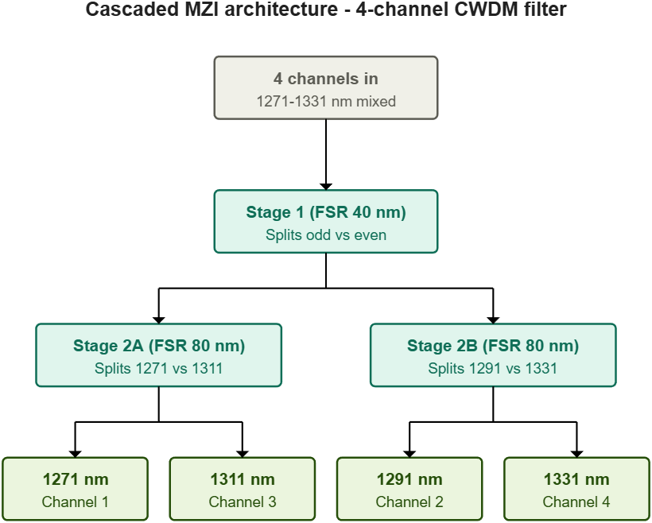
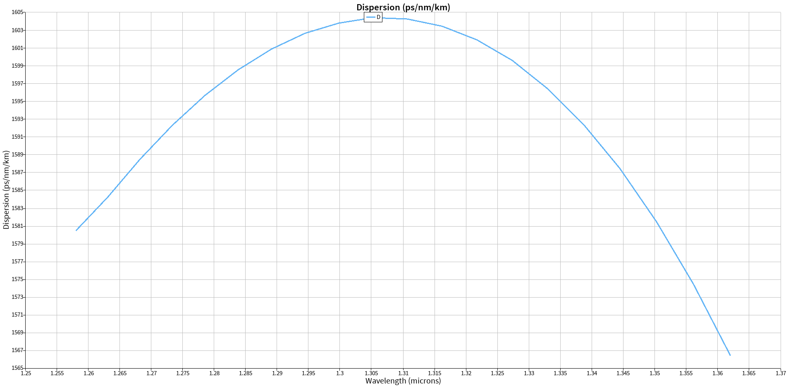
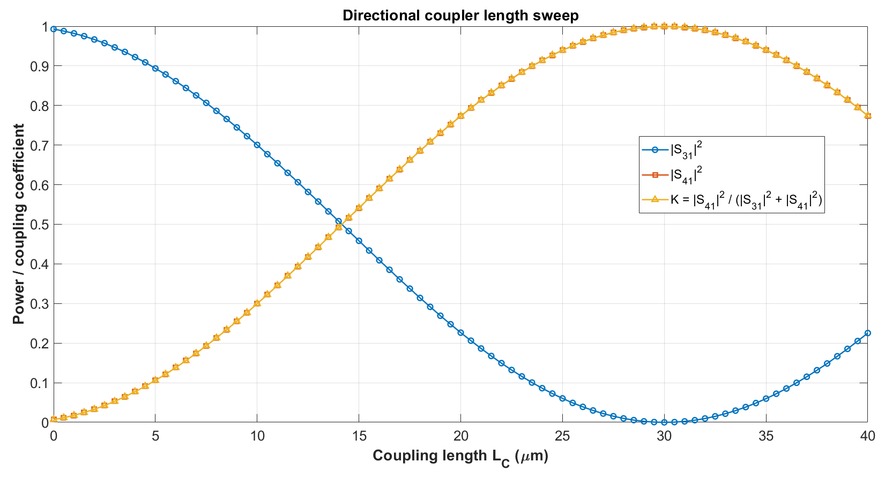
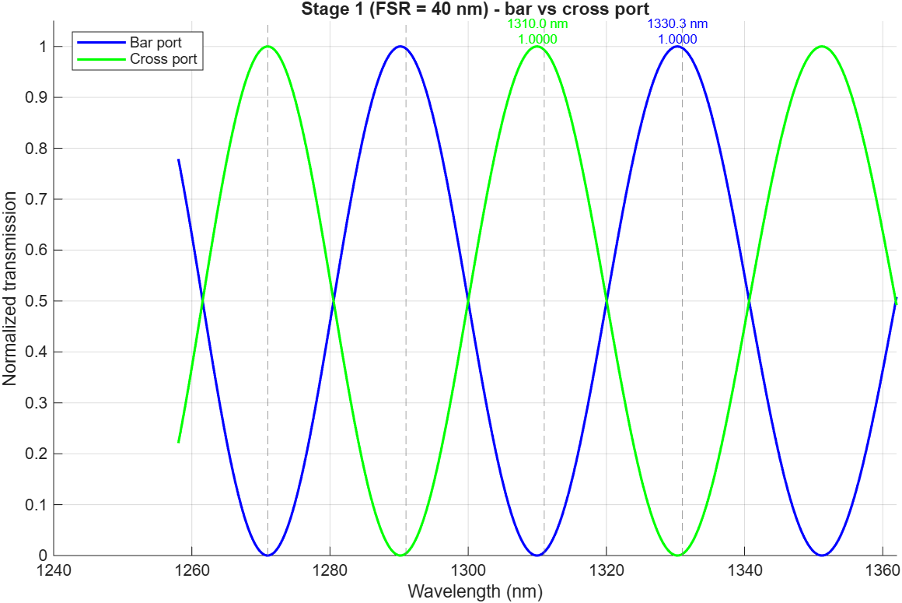
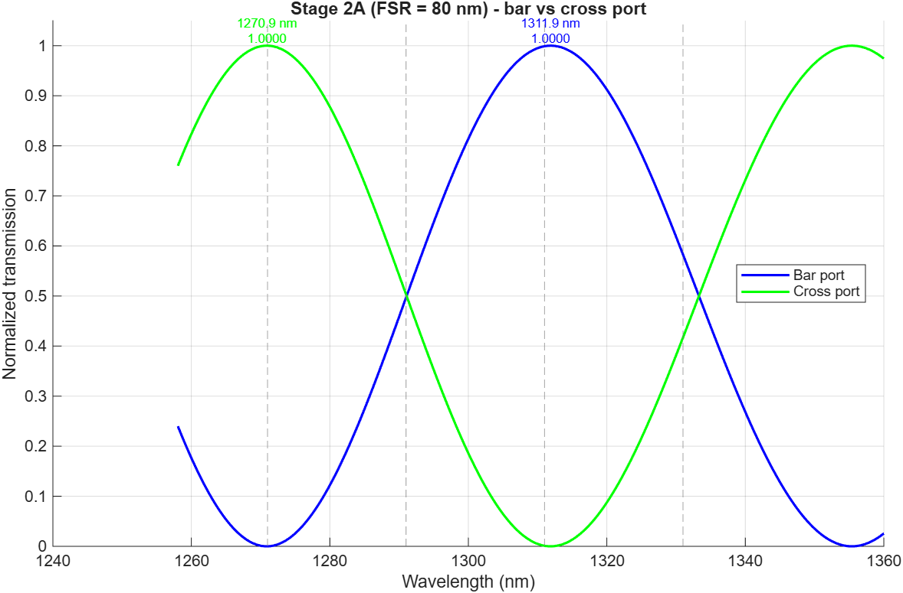
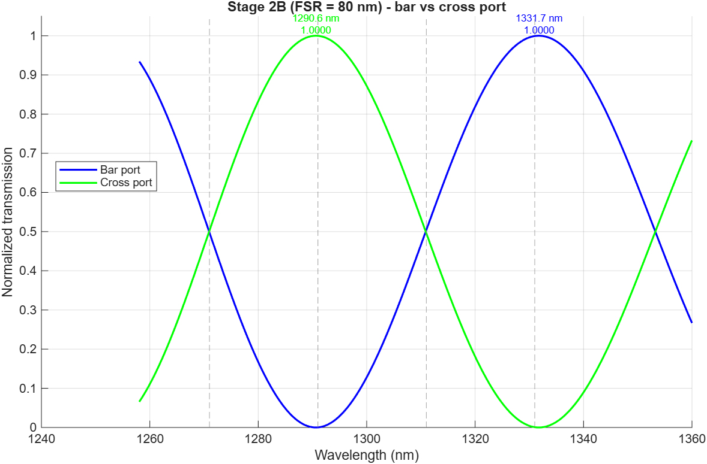
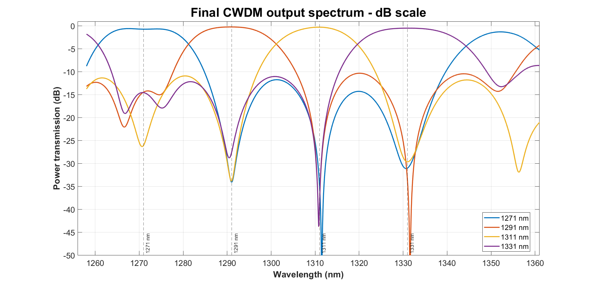

# 01 · 4-Channel CWDM Demultiplexer (220 nm SOI)

## Goal

Design a passive silicon demultiplexer for the O-band CWDM grid (**1271, 1291, 1311, 1331 nm**). Each output should have:

- insertion loss below 1 dB;
- a wide, flat passband (1-dB bandwidth of at least 12 nm in the ±6 nm channel window);
- low crosstalk.

## Architecture

The demultiplexer is a two-stage tree of Mach–Zehnder lattice filters:

- **Stage 1:** FSR = 40 nm. Separates {1271, 1311} from {1291, 1331}. It is a 3rd-order lattice, which gives flat-top passbands.
- **Stages 2A / 2B:** FSR = 80 nm. Each separates the two remaining channels.

The path-length difference follows from FSR = λ² / (n_g · ΔL):

| Stage | FSR | ΔL |
|-------|-----|----|
| 1 | 40 nm | ≈ 10.07 µm |
| 2A | 80 nm | 4.788 µm |
| 2B | 80 nm | 4.909 µm |

In the 3rd-order Stage 1 lattice, the delays set where the channels sit, and the four coupling ratios shape the passband: κ = 0.823 / 0.721 / 0.186 / 0.092.

## Design flow

| Step | Tool | Output |
|------|------|--------|
| 1. Waveguide | MODE FDE | 420 nm × 220 nm strip, single-mode; n_eff(λ) and n_g ≈ 4.2 |
| 2. Ideal circuit | INTERCONNECT | ΔL and κ values for each stage (ideal couplers) |
| 3. 50:50 splitter | EME → FDTD | 1×2 MMI, 4.5 µm × 30 µm, with tapers |
| 4. Directional couplers | EME → FDTD | 140 nm gap; coupling length swept to hit each κ; S-parameters exported |
| 5. Back-annotation | INTERCONNECT | Ideal blocks replaced by FDTD S-parameters and dispersive MODE waveguides |

  
  

  
  
  

## Results (back-annotated circuit)

| λ (nm) | IL (dB) | 1-dB BW (nm) | XT at centre (dB) |
|--------|---------|--------------|-------------------|
| 1271 | 0.70 | 14.9 | −13.7 |
| 1291 | 0.22 | 12.5 | −27.3 |
| 1311 | 0.26 | 10.5 | −34.6 |
| 1331 | 0.48 | 15.7 | −29.1 |

All four channels have IL below 1 dB. Two channels miss one spec each:

- **1271 nm** misses on crosstalk.
- **1311 nm** misses on bandwidth.

The main cause is that the κ values from FDTD drift away from the EME targets. The couplers are also dispersive, while the optimisation assumed a constant κ.

The crosstalk above is measured at the channel centre. Measured over the whole passband it is worse.

## What I would improve

- Optimise directly with the FDTD S-parameters instead of ideal κ.
- Evaluate crosstalk over the full passband.
- Use broadband (wavelength-flattened) couplers.
- Run tolerance sweeps on gap and width for fabrication robustness.

## Files

- `scripts/1_waveguide_mode/`: FDE geometry, convergence and width sweeps
- `scripts/2_mmi_eme/`, `scripts/3_mmi_fdtd/`: MMI geometry, EME length/width sweeps, FDTD verification
- `scripts/4_directional_coupler/`: one FDTD script per coupler κ, EME coupling-length sweep, κ extraction
- `scripts/5_circuit_analysis/`: MATLAB script for IL, bandwidth, crosstalk and ripple from the INTERCONNECT data
- `interconnect/`: ideal stage circuits, the full ideal filter, and the final back-annotated filter
- `data/`: FDTD S-parameters (`.dat`), waveguide model (`.ldf`), exported spectrum
