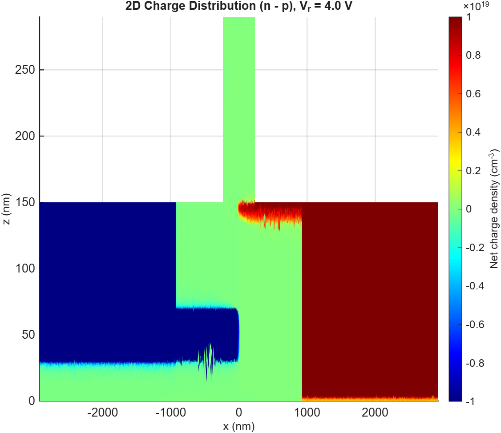
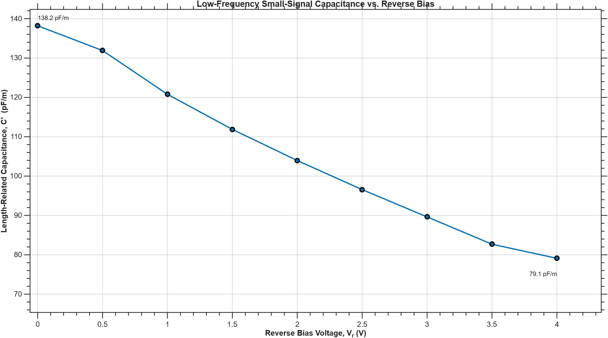
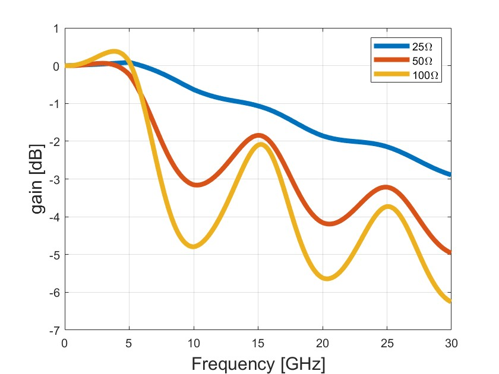
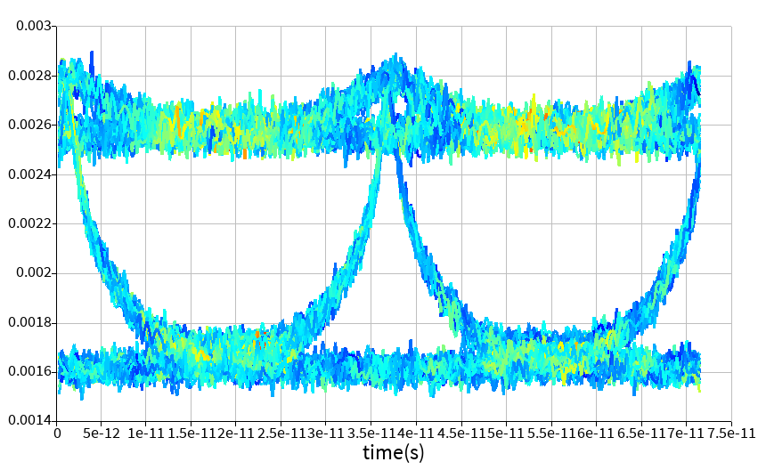
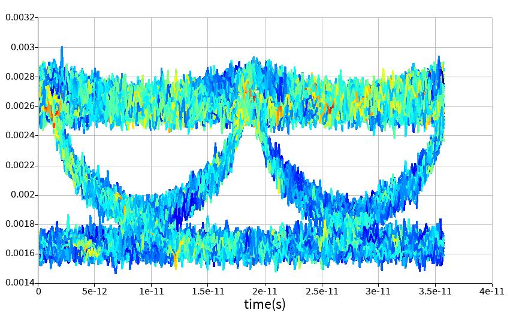
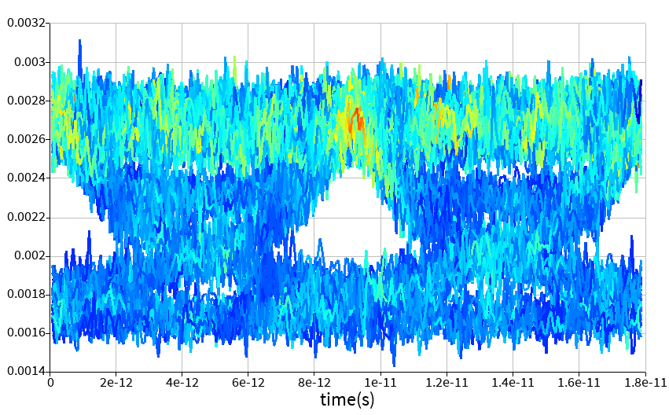

# 02 · Silicon Travelling-Wave Mach–Zehnder Modulator

## Goal

Design a carrier-depletion silicon MZM with **30 GHz EO bandwidth** for **56 Gbit/s OOK**.

## Device

The phase shifter is a lateral pn junction:

- **Waveguide:** a 470 nm rib on a 150 nm slab, with Al contacts.
- **Modulation:** reverse bias widens the depletion region. This changes the refractive index through the plasma-dispersion effect.
- **Electrode:** a GSG travelling-wave electrode runs alongside both arms (push-pull), so the RF signal travels with the light.

## Simulation chain

| Step | Tool | What it gives |
|------|------|---------------|
| 1. Junction | CHARGE | Carrier distribution, C(V): 385 → 284 pF/m (0 → −4 V); RC cutoff of 160–220 GHz |
| 2. Optical mode | MODE FDE | Δn_eff and loss vs bias; L = 3.5 mm gives Δφ ≈ 2.65 rad at 4 V |
| 3. RF electrode | MODE (RF) | Z₀(f), RF index 3.85–4.2, RF loss vs frequency |
| 4. System | INTERCONNECT | EO S21 vs termination, ONA spectrum, eye diagrams, BER |

  
  

## Results

- **Velocity matching:** the optical n_g (≈ 3.96) is close to the RF index (3.85–4.2). This alone would allow about 266 GHz.
- **RF loss is the real limit:** it exceeds 10 dB/cm at 30 GHz.
- **Termination:** 25 Ω gives the flattest response and reaches the **30 GHz** target.

Eye diagrams and BER:

| 28 Gbit/s | 56 Gbit/s | 112 Gbit/s |
|---|---|---|
|  |  |  |
| log₁₀ BER ≈ −74 | log₁₀ BER ≈ −26 | log₁₀ BER ≈ −5 |

## What I learned / would improve

- The compact model depends on mapping the CHARGE, FDE and RF results into INTERCONNECT correctly. Units (dB/m vs dB/cm), drive swing and lengths all matter, and small mapping errors change the eye completely.
- High optical loss (about 70 dB/cm) gives a large insertion loss. Selective doping near the junction would reduce it.
- A redesigned electrode with lower RF loss, keeping the RF index near 4, would push the bandwidth higher.

## Files

- `scripts/1_charge/`: DC (C–V, carriers) and AC (RC) CHARGE scripts
- `scripts/2_optical_mode/`: FDE setup, mesh override, bias sweep
- `scripts/3_rf_electrode/`: RF mode solver for Z₀, n_RF and loss
- `scripts/4_interconnect/`: ENA (EO S21), eye/BER and ONA scripts, plus a plotting script
- `interconnect/`: ENA and push-pull eye circuits
- `data/`: Z₀/loss/n_g vs frequency, C(V) results, gain curves for 25/50/100 Ω
