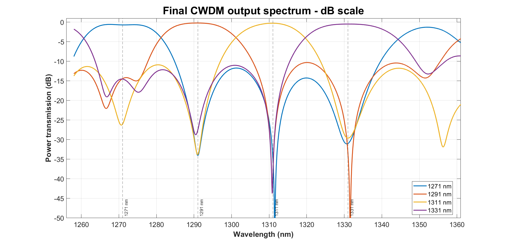
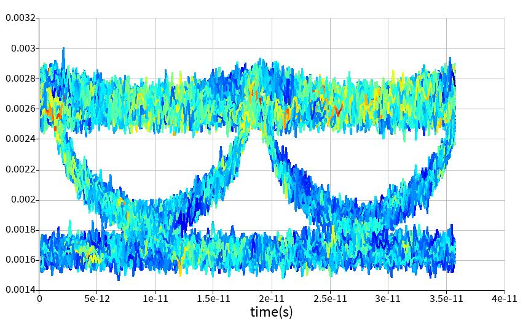

# Silicon Photonics Design Projects

Two photonic integrated circuit (PIC) design projects from the **Photonic Integrated Circuit Design & Applications (PICDA)** course at the **Karlsruhe Institute of Technology (KIT)**, 2026. Both follow the full design flow, from mode solver to device simulation to circuit model, using the Ansys Lumerical suite.

| # | Project | What it does | Tools |
|---|---------|--------------|-------|
| 01 | [**4-channel CWDM demultiplexer**](01-cwdm-demultiplexer/) | Splits 1271 / 1291 / 1311 / 1331 nm onto four outputs with a cascaded Mach–Zehnder lattice-filter tree on 220 nm SOI | MODE (FDE), EME, FDTD, INTERCONNECT |
| 02 | [**Travelling-wave Mach–Zehnder modulator**](02-travelling-wave-mzm/) | Silicon pn-depletion modulator targeting 30 GHz EO bandwidth for 56 Gbit/s OOK | CHARGE, MODE (FDE + RF), INTERCONNECT |

<p align="center">
  
  
</p>

## Design flow

```
Waveguide (MODE FDE)  →  Devices (EME / FDTD / CHARGE)  →  S-parameters / compact models  →  Circuit (INTERCONNECT)
     n_eff, n_g              MMI, couplers, pn junction        back-annotation                  spectrum, eye, BER
```

## Key results

**CWDM demux:** insertion loss below 1 dB on all four channels after back-annotating the FDTD coupler S-parameters. Two channels pass every spec; 1271 nm is limited by crosstalk and 1311 nm by bandwidth.

**TW-MZM:**
- Bandwidth: 30 GHz EO bandwidth with a 25 Ω termination.
- Eye diagrams: open eyes at 28 and 56 Gbit/s.
- Limiting factor: RF electrode loss, not velocity mismatch.

## Repository layout

```
01-cwdm-demultiplexer/   scripts (.lsf/.m/.py), INTERCONNECT circuits, S-parameter data, figures
02-travelling-wave-mzm/  scripts (.lsf/.m), RF/C(V) data, INTERCONNECT circuits, figures
```

Large Lumerical project files (`.lms`, `.fsp`, `.ldev`, result archives) are left out to keep the repository light. You can regenerate them with the scripts, given a Lumerical licence.

## Team & credits

This was group work (Group 13). Team: **Diego Arteaga Palomo**, **Syed Ahmed Ibrahim Bukhari**, **Mohamed Mansour**, **Daryna Sych**.
The complete team repository with all simulation files is at [diegoartpal/PICDA_PDA](https://github.com/diegoartpal/PICDA_PDA).

My main contributions:
- **Project A:** the INTERCONNECT filter design (FSR 40/80 nm stages, full filter assembly).
- **Project B:** the CHARGE junction analysis (band edges, charge distribution, E-field, C(V)) and the system simulations.

The course material and the Lumerical example base files belong to KIT and Ansys respectively.
